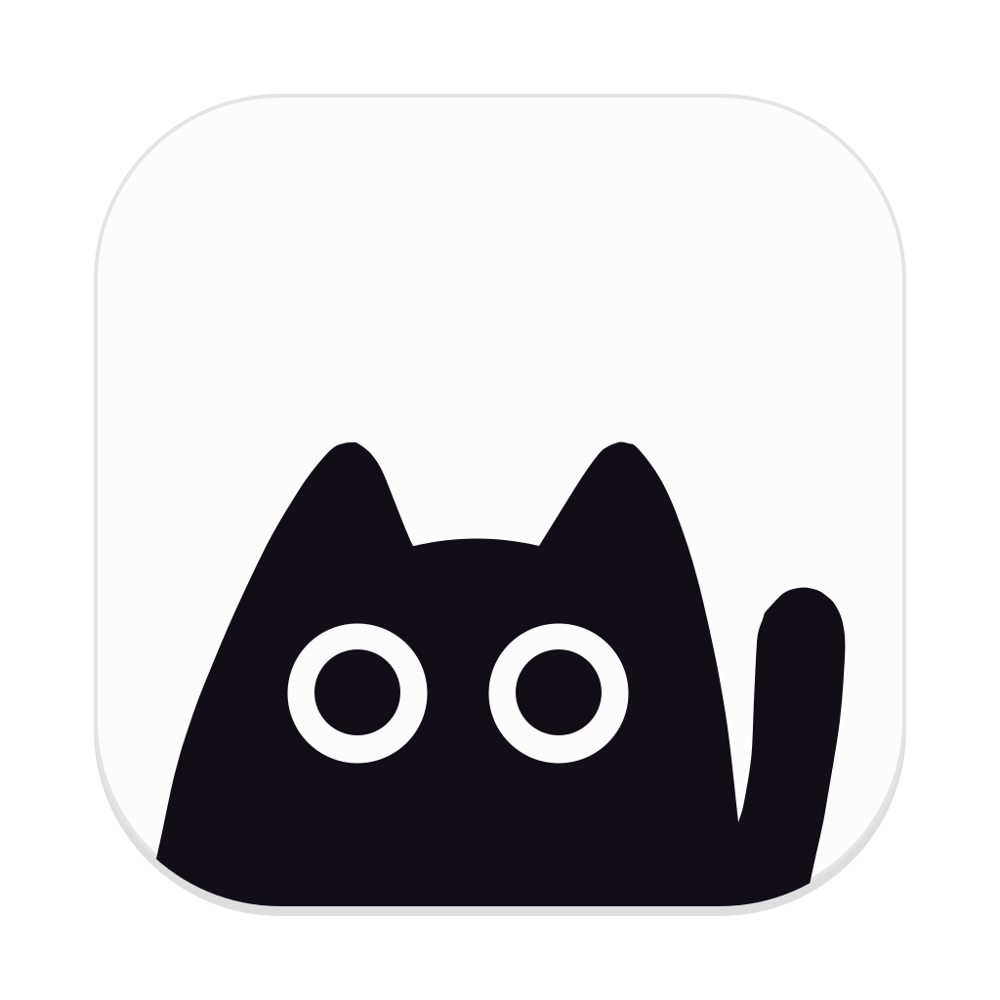

# Maeng Mate

Mac 메뉴바에서 직접 연결한 Notion 표에서 보고 싶은 항목을 확인하고 출퇴근을 기록하는 앱입니다. 여러 표에 흩어진 마감일과 회의를 달력 하나에 모아 보고, 항목을 누르면 Notion 원본으로 이동합니다.

[공식 사이트](https://maeng-mate.lucidalpaca32.chatgpt.site) · [최신 버전 다운로드](https://github.com/723poil/maeng-mate/releases/latest) · [사용 가이드](docs/usage.md) · [릴리스 노트](https://github.com/723poil/maeng-mate/releases)

## 주요 기능

- **내 목록** — 카테고리를 직접 만들고 메뉴바에 표시할 카드를 선택합니다. 자주 보는 카드를 위에 두거나 마감일과 우선순위로 목록을 정렬할 수 있습니다.
- **출퇴근 기록** — 출근 시각을 입력하면 휴게 시간과 휴가를 반영해 퇴근 예정 시각을 계산합니다. 실제 퇴근 시각은 월별 기록에서 확인하고 수정할 수 있습니다.
- **알림** — 카테고리의 저장 칼럼과 직접 입력한 값으로 규칙을 만들고 macOS 알림이나 Slack DM으로 받습니다. 퇴근 알림은 받을 시각을 분 단위로 직접 정합니다.
- **AI에서 조회** — Codex나 Claude Code를 읽기 전용 MCP에 연결하면 “오늘 내 회의가 뭐야?”처럼 물어볼 수 있습니다. 앱 설정에서 두 클라이언트의 업무 조회 스킬을 설치하고 업데이트할 수 있습니다.

## 앱 설치

**Apple Silicon Mac과 macOS 26 이상**이 필요합니다. 배포 앱에 Python과 의존성이 포함되어 있습니다.

1. [최신 릴리스](https://github.com/723poil/maeng-mate/releases/latest)의 **Assets**에서 `.dmg` 파일을 내려받아 엽니다.
2. **Maeng Mate.app**을 **응용 프로그램(Applications)** 폴더로 옮긴 뒤 실행합니다.
3. 메뉴바에서 Maeng Mate 아이콘을 누릅니다. 첫 실행 때 다음 로그인부터 자동으로 시작하도록 등록됩니다.

현재 배포본은 로컬 개발 서명을 사용하며 Apple 공증을 받지 않았습니다. 메뉴바 앱이 하루 간격으로 새 버전을 확인합니다. 새 버전이 있으면 변경 내용을 보고 지금 설치하거나 나중으로 미룰 수 있습니다. 설정 왼쪽 아래의 **업데이트 확인…**으로 언제든 직접 확인할 수도 있습니다. 버튼이 없는 이전 버전은 앱을 종료하고 최신 DMG로 한 번 교체하세요. 앱은 기존 데이터베이스를 백업하고 기록과 설정을 이어서 사용합니다.

## 처음 Notion 연결하기

1. 메뉴바의 톱니바퀴에서 **설정 → 연동 → Notion**을 엽니다. 사용할 표에 접근할 수 있는 연동 토큰과 내 Notion 사용자 ID를 입력하고 연결을 확인합니다.
2. **카테고리**에서 ‘업무’나 ‘회의’처럼 메뉴바에 표시할 카드 이름을 정합니다. **수집 소스**에서 카테고리를 선택하고 Notion 표를 연결한 뒤, 표의 속성을 앱에서 사용할 칼럼에 맞춥니다.
3. 저장 후 **다시 시작** 안내가 나오면 앱을 재시작합니다. 첫 수집이 끝나면 메뉴바에서 연결한 항목을 확인할 수 있습니다.

수집한 업무와 출퇴근 기록은 Mac의 SQLite에 저장하고, Notion·Slack 토큰은 macOS 키체인에 보관합니다. Slack DM과 AI 조회는 필요할 때 각각 연결할 수 있습니다. [알림과 Slack 설정](docs/usage.md#설정) · [MCP 연결](docs/usage.md#mcp)

## 개발 환경

지원되는 Mac에서 저장소를 복제한 뒤, 프로젝트 루트에서 실행하세요. mise가 저장소에 고정된 Python 3.12와 uv를 설치합니다.

```sh
git clone https://github.com/723poil/maeng-mate.git
cd maeng-mate
mise trust
mise install
mise exec -- uv sync --locked --extra menubar
mise run check
```

개발용 메뉴바(D 배지)와 배포용 메뉴바를 같은 Mac에서 함께 실행할 수 있습니다. 개발용은 전용 DB와 키체인으로 시작합니다. 기존 설치의 기록과 연동은 배포용에서 이어서 사용합니다.

| 작업 | 프로젝트 루트에서 실행할 명령 |
| --- | --- |
| 로컬 DB 준비 | `mise exec -- uv run maeng-mate migrate` |
| 메뉴바 앱과 백그라운드 서비스 설치·갱신 | `mise exec -- uv run maeng-mate service install` |
| 서비스 상태 확인 | `mise exec -- uv run maeng-mate service status` |
| 앱과 설치 파일 빌드 | `mise run package` |

`mise run check`는 Ruff·포맷·mypy를 검사합니다. 패키지 빌드 결과인 앱, DMG, SHA-256 파일은 `dist/`에 생성됩니다.

## 프로젝트 문서

- [사용 및 운영 가이드](docs/usage.md) — 메뉴바·캘린더 설정, 알림, 서비스 명령, MCP 도구
- [아키텍처 결정 기록](docs/adr/README.md) — Notion 수집, 로컬 저장소, API와 메뉴바 앱의 역할
- [개발 작업 지침](AGENTS.md) · [릴리스 절차](docs/adr/0010-macos-distribution.md#릴리스-브랜치와-github-actions)

## 라이선스

Maeng Mate의 코드와 문서는 [MIT 라이선스](LICENSE)로 배포합니다. 복사본이나 코드의 상당 부분을 재배포할 때는 저작권 표시와 라이선스 문구를 함께 제공하세요.

외부 구성요소에는 각각의 라이선스가 적용됩니다. 배포 앱의 Sparkle 고지는 앱 번들의 `Contents/Resources/Sparkle-LICENSE`에, 웹사이트의 Pretendard 글꼴 고지는 [OFL.txt](site/assets/fonts/OFL.txt)에 있습니다.
