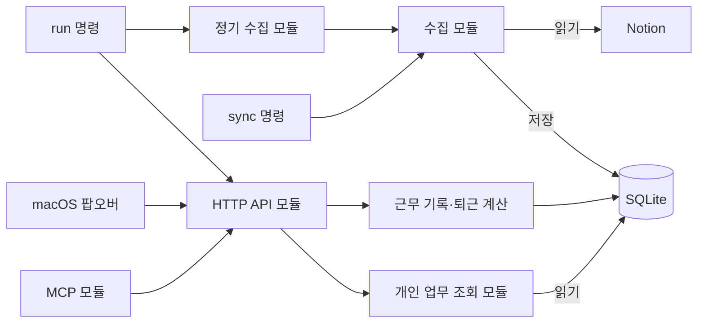

# 사용 및 운영 가이드

[앱 설치와 첫 설정은 README에서 확인하세요.](../README.md#앱-설치)

## 실행

```sh
uv run maeng-mate service start
uv run maeng-mate service stop
```

개별 실행:

```sh
uv run maeng-mate api   # 조회 API만 실행
uv run maeng-mate sync  # Notion 한 번 수집
```

- 개발용 API는 `127.0.0.1:43128`, 배포용 API는 `127.0.0.1:43127`을 기본으로 사용한다. `GET /v1/status`와 `GET /v1/today?date=YYYY-MM-DD` 조회에는 Bearer 인증이 필요하다.
- DB는 실행본의 지원 폴더 아래 `data/maeng-mate.sqlite3`에 저장한다. 개발용 지원 폴더는 `~/Library/Application Support/MaengMateDev/`, 배포용은 `~/Library/Application Support/MaengMate/`다.
- 수집: `연동 → Notion`에서 토큰을 등록한다. `수집 소스`에서 원본 표 주소나 데이터 소스 ID로 칼럼을 조회하고 연결한다. 매핑은 SQLite `work_settings`의 JSON에 저장한다.
- 개인 조회: Notion 설정의 사용자 ID와 업무·회의 소스가 필요하다. task 소스의 `completedStatuses`에 완료 상태 이름을 넣는다.
- 일정 분류: meeting 소스의 `properties.category`, `properties.cancelled`, `eventTypes`로 연결한다.
- 기존 설정은 `uv run maeng-mate settings import-work --file <JSON 경로>`로 한 번 가져온다. 이후에는 DB만 사용한다.

`run`은 기본 15분 간격으로 소스를 순서대로 수집한다. 팝오버 상단에서 1·5·10·15·30·60분으로 변경한다. 변경값은 SQLite에 저장해 재실행 후에도 유지한다. `SYNC_INTERVAL_SECONDS`는 저장된 선택이 없을 때의 기본값이다(60~86400초). 소스별 수집 종료 후 다음 예약을 SQLite에 저장하며, 재시작·절전 복귀 시 지난 예약은 한 번만 실행한다. 실패 시 이전 정상 자료를 유지한다. 일시 오류는 15·30·60초 간격으로 최대3회 재시도하고 복구·소진 후 정기 주기로 돌아간다. 요청 제한의 서버 대기 지시를 우선한다. 인증·권한·매핑 오류는 빠른 재시도 없이 알린다.

종료하면 API와 수집을 함께 정리한다. `/v1/status`의 `periodicSync`에서 활성 여부, 실행 중 여부, 다음 예정 시각과 소스별 성공·실패 개수를 확인한다. 업데이트 후 `migrate`는 기존 자료를 유지하며 필요한 테이블을 추가한다.

## macOS 팝오버

macOS 26 기본 유리 효과를 투명 패널 하나에 표시한다. 카드 내부 불투명도는 90%다. 확대·축소는 상단 위치와 목록의 읽던 위치를 유지한다.

```sh
uv sync --locked --extra menubar
uv run maeng-mate migrate
```

개별 메뉴바 실행도 앱 시작 정보와 Keychain의 내부 API 키를 사용한다.

```sh
uv run --extra menubar maeng-mate menubar
```

근무 카드의 `기록 ↗`에서 월별 출근·휴가·실제 퇴근과 수정 이력을 본다. 날짜를 선택하고 퇴근 예정시간 옆의 `확정`을 누르면 그 시간으로 퇴근을 기록한다. 직접 조정할 때는 시·분·휴가를 고치고 수정 영역의 `저장`을 누른다. 실제 퇴근 미입력은 미기록으로 표시한다. 오늘 퇴근을 저장하면 메뉴바에도 실제 시간을 표시하고 남은 퇴근 알림을 취소한다. 과거 정정은 알림을 보내지 않는다.

기록 목록은 토요일 파랑·일요일 빨강으로 휴무일도 표시한다. 평일은 야근, 주말은 주말근무 체크박스를 선택하고 저장한다. 체크한 날은 퇴근시간 옆에 같은 문구의 배지가 표시된다.

출근 시·분과 휴가를 한 줄에서 선택하면 퇴근 예정을 계산하고 자동 저장한다. 처음에는 입력한 출근 시각을 기준으로 계산한다. **설정 → 근무 규칙**에서 휴게 구간과 휴가 차감 시간을 지정하면 퇴근 예정에 반영된다. 저장 상태는 퇴근 예정 옆 괄호에 표시한다. 출근·휴가·수정 이력은 SQLite에 남는다. 주말에도 실제 출근·퇴근을 입력할 수 있다. 예정 퇴근과 자동 퇴근 알림은 설정된 근무 요일에 동작한다. 날짜가 바뀌면 새 날짜의 미기록 상태로 전환하며 이전 기록은 보존한다.

같은 카테고리에 연결한 소스는 카드 하나에 모인다. `화면`에서 카드 순서와 표시 여부를 바꾸고, 항목을 눌러 원본을 연다.

**설정 → 카테고리 → 설정… → 저장 칼럼**에서 상태 칼럼의 **추가 표시**를 켭니다. **메뉴바 표시 → 자동**은 Notion 상태 속성과 업무 상태에 연결한 칼럼의 값을 제목 앞에 배지로 표시합니다. 선택이나 텍스트 속성에 상태를 저장한다면 **상태 배지**를 고르세요. **텍스트**를 고르면 제목 뒤에 값만 표시합니다. 행에 포인터를 올리면 칼럼 이름과 값을 함께 확인할 수 있습니다.

카드 안에서 볼 항목과 순서는 **설정 → 카테고리 → 설정… → 메인 목록**에서 정한다. 예를 들어 상태가 ‘완료’인 항목을 제외하고, 우선순위가 ‘긴급 → 보통 → 낮음’인 순서로 본 뒤 같은 우선순위 안에서 마감이 가까운 순으로 정렬할 수 있다. 여러 표가 한 카드에 연결돼 있어도 이 순서로 함께 표시한다. 표시 필터와 숨김 조건이 모두 비어 있으면 오래된 완료 항목과 다른 날짜의 일정도 표시한다. 오늘 회의만 보려면 회의 카드에 `오늘 일정 → 같음 → 예`를 추가한다. 저장 후 앱을 다시 시작하면 적용된다.

기존 카드는 업데이트 후 앱을 처음 실행할 때 이전에 쓰던 표시 방식을 편집 가능한 규칙으로 이어받는다. 예를 들어 업무 카드의 `숨김 조건`에서 완료 업무의 기한 경과 일수를 바꾸고, `정렬 순서`에서 상태 그룹의 우선순위를 옮길 수 있다. 새 카드는 규칙 없이 시작한다. 기존 카드에서 지운 규칙은 앱을 다시 시작해도 복원되지 않는다.

목록은 하나의 표에서 읽을 수 있다. 회차마다 별도의 하위 표를 사용하는 경우에는 수집 소스에서 차시별 수집을 선택한다. 완료로 취급할 상태와 오늘 목록에 표시할 기간은 소스별로 설정한다.

근무 규칙은 **설정 → 근무 규칙**에서 조합한다. 요일·실근무·출근 범위·휴게·휴가 차감을 바꿀 수 있다. 추가 휴게는 `+`로 필요한 만큼 추가한다. 저장한 파일은 실행본 지원 폴더의 `work-rules.json`이다. 저장하면 오늘 입력한 출근에도 즉시 적용돼 퇴근 예정과 남은 알림 시각이 바뀐다. 이미 입력한 실제 퇴근과 지난 날짜의 기록은 유지한다. 기록 API는 인증된 `GET /v1/day`·`PUT /v1/day`다. 메뉴바 종료는 API·수집 종료와 별개다.

새로고침·수집·주기 저장 중에는 회전 표시와 진행 문구를 보여주고 기존 목록을 유지한다. 새로고침 버튼은 저장된 자료를 다시 읽는다.

새 설치에서는 알림이 꺼져 있다. **설정 → 알림**에서 알림 사용과 받을 채널을 켠다. **카테고리 → 설정… → 알림 규칙 → + 새 규칙**에서 **기준 데이터**로 카테고리의 저장 칼럼이나 **수집 상태**를 선택한다. 이름과 조건을 정한 뒤 **이 규칙 사용**을 켠다. 규칙마다 **알림 문구**에 보낼 본문을 쓰고 **전달 채널**에서 macOS 알림, Slack DM 또는 둘 다 고른다. 채널을 비워 두면 보내지 않는다. 전체와 카테고리 설정에서도 받을 채널을 켜야 한다. 기존 규칙을 열면 적용 중인 채널과 문구가 입력란에 표시된다. 항목마다 달라지는 제목이나 변경 내용은 발송할 때 채워진다.

특정 표의 데이터로 범위를 좁히려면 규칙 편집에서 **대상 소스 → 선택한 소스만**을 선택한다. 표를 고르고 **이 소스 포함**을 켠 뒤 **원본 속성 조건**에서 그 표의 속성과 값을 선택한다. 상태·선택 속성의 값 목록은 연결한 Notion 표에서 읽는다. 여러 표가 같은 카테고리를 쓰더라도 각 표의 조건은 따로 정할 수 있다. **공통 저장 칼럼**에는 선택한 표들에 함께 적용할 조건을 둔다. 공통 조건의 비교값과 **변경 후 값**에는 최근 정상 수집에서 확인한 상태·선택값이 표시된다. 목록에 아직 없는 값은 직접 입력할 수 있다. 규칙에서 **적용**하고 카테고리에서 **저장**한 뒤, 수집 설정 변경 안내에 따라 앱을 다시 시작한다.

퇴근 알림은 받을 시각을 퇴근 몇 분 전인지 입력하고 **적용**한다. 여러 시각은 쉼표로 구분하고, 모두 해제하려면 빈칸으로 적용한다. 값 변경 알림은 첫 수집과 수집 매핑 변경 때 비교 기준만 저장한다. 업무 변경 이력은 SQLite의 `task_changes`에 남고 같은 수집 결과를 다시 알리지 않는다. 출근·휴가 정정은 대기 중인 퇴근 예약도 갱신한다. 재실행하면 저장된 오늘 기록의 누락된 미래 예약을 보완한다. 지난 시각은 소급 요청하지 않는다. 같은 날짜의 각 퇴근 알림은 한 번만 요청하며 예약·처리 이력은 SQLite에 남는다. 알림 전달은 메뉴바가 실행 중일 때 동작한다. 수집 실패 규칙을 등록하고 켜면 배너로 알리며 같은 장애가 이어지면 반복하지 않는다. 복구된 소스의 미전달 오류 알림은 취소한다.

**기준 데이터**에서 날짜·시간 칼럼을 고른 뒤 **전날 지정 시각**, **당일 지정 시각**, **시작 시각 몇 분 전** 중 하나를 고른다. 전날·당일은 서울 기준 24시간제 시각을, 시작 전은 분을 직접 입력한다. 날짜 범위는 시작값을 사용한다. 시작 시각이 없는 종일 값은 전날·당일 규칙으로 알릴 수 있다. 카테고리 설정을 저장하고 재시작이 필요하다고 표시되면 적용한다. 수집을 시작하면 처음 확인한 미래 건부터 예약하고, 재수집에서 일정이 바뀌거나 빠지면 예약도 갱신한다.

Notion 업무·QA·일정·회의 알림은 macOS 배너나 Slack DM의 제목을 누르면 해당 원본을 연다.

업데이트하면 기존 알림은 같은 이름의 편집 가능한 규칙으로 옮겨진다. 회의 시작 알림을 선택하면 연결된 일정 칼럼, ‘시작 시각 몇 분 전’, 저장된 분이 보인다. 분을 직접 바꾸거나 다른 날짜 칼럼을 고를 수 있다. 담당·참여 알림에서는 사람 칼럼과 내 계정 또는 특정 사용자 ID를 선택한다. 기한 칼럼처럼 실제 연결이 없는 규칙은 꺼진 상태로 남는다. 기준 칼럼을 지정한 뒤 **이 규칙 사용**을 켠다. 수집 실패 알림은 **수집 상태**에서 오류 범위를 설정한다.

## 캘린더

상단 달력 아이콘으로 별도 창을 연다. `설정 → 화면 → 캘린더`를 켜면 메인에도 작은 달력을 표시한다. 표시 순서는 같은 화면에서 바꾼다.

카테고리와 출근 기록은 메인의 필터 아이콘이나 별도 창의 왼쪽 목록에서 켜고 끈다. 선택은 두 화면에서 공유한다. 출근 기록은 시계, 퇴근 확정은 체크 아이콘으로 표시하고 시간은 날짜 상세에서 확인한다.

캘린더는 메인 목록의 상태 필터와 별개로 완료·보류·이전 차시도 표시한다. 업무·QA 상세에 상태와 기간의 시작일·기한을 표시한다. 기간이 있으면 달력에도 시작~기한 범위로 표시하며, 날짜가 하나뿐이면 기한만 표시한다. 월 이동·오늘·날짜 선택과 Notion 원본 이동을 지원한다. 현재 수집 자료를 읽는 기능이며 갱신 지연·일부 표시 여부는 화면에 표시한다.

## 설정

메뉴바 톱니바퀴에서 연다. `카테고리`에서 이름을 정하고 필요한 저장 칼럼·캘린더·알림 규칙을 만든다. `수집 소스`에서 카테고리와 수집 방식(목록·일정)을 고른 뒤 `연결 편집`에서 실제 표의 속성을 연결한다. 등록한 규칙은 `알림`에서 카테고리별로 켜고 끌 수 있다.

전체 알림·전달 채널·알림 종류는 스위치로 켜고 끈다. 여러 채널을 함께 선택할 수 있다. `발신 앱`에서 알림 배너의 앱 이름·아이콘을 바꾸고 `적용`한다. PNG·JPEG·ICNS를 선택할 수 있고 원본 파일 대신 변환한 아이콘을 SQLite에 저장한다. `알림 확인`에서 최초 macOS 알림 권한을 허용한다. 전달 채널에서 macOS 알림과 Slack DM을 각각 선택한다. Slack은 저장된 본인 멤버 ID·봇 토큰을 사용하며 앱 토큰은 필요 없다. 채널별 결과를 따로 기록하고 발송 여부가 불확실하면 자동 재전송하지 않는다. 화면 숨김은 수집·알림을 중단하지 않는다.

일반·Notion 설정은 SQLite의 `runtime_settings`에 저장한다. `연동 → Notion`의 ‘내 Notion ID’에는 본인의 사용자 ID를 입력한다. ‘목록 범위’에서 ‘담당 업무와 참여 일정’을 고르면 내가 참여자로 등록된 일정도 목록에 표시한다. 표의 이동 주소는 `수집 소스 → 열기 주소`에서 바꾸면 바로 반영된다. 저장 후 적용 대기가 표시되면 `다시 시작`을 누른다.

Notion 토큰은 `연동 → Notion`에서 확인 후 저장·연결 확인·삭제한다. 토큰은 macOS Keychain에 보관하며 화면에서 다시 조회하지 않는다. 변경·삭제는 다시 시작 후 적용한다. 미등록 상태에서도 설정 화면은 열리며 수집은 중단된다.

`연동 → Slack`에서 본인 멤버 ID와 봇·앱 토큰을 등록한다. ID는 SQLite, 토큰은 Keychain에 각각 저장한다. `연결 확인`은 저장된 봇 토큰의 인증만 검사한다. 봇 인증과 멤버 ID 저장을 마치면 `테스트 알림`으로 본인에게 DM 한 건을 보낸다. 봇에 `chat:write` 권한이 필요하다. 자동 DM은 `알림 → 전달 채널 → Slack DM`을 켜면 사용한다. 앱 토큰은 보관만 하며 Socket Mode는 아직 연결하지 않는다.

내부 API 인증은 Keychain, 시작 위치·포트는 실행본 지원 폴더의 `bootstrap.json`, 일반·계정 설정과 수집 주기는 SQLite에 둔다. 소스 매핑·페이지 링크·QA 규칙은 SQLite의 `work_settings` JSON 문서에 저장한다. 링크 입력은 해당 소스의 `pageUrl`만 수정한다. `config` 폴더는 사용하지 않는다.

### 데이터 백업과 전체 복원

**설정 → 데이터 백업 → 백업하기…**에서 저장 위치와 새 파일 이름을 선택한다. `.maengbackup` 파일 하나에 출퇴근 기록, 수집한 업무 데이터, 앱 설정과 근무 규칙이 담긴다. 파일을 다른 Mac으로 옮기는 경우 Notion·Slack 인증과 MCP 접근 권한은 그 Mac에서 설정한다.

**백업 불러오기…**에서 파일을 고르고 생성 시각을 확인한 뒤 **전체 복원**을 누르면 해당 시점의 데이터로 교체하고 앱을 다시 시작한다. 복원 직전 데이터는 실행본 지원 폴더의 `backups/`의 `pre-restore-*.maengbackup`으로 보관한다. 이 파일도 같은 버튼으로 불러올 수 있다.

## 로그인 자동 실행

DB를 준비한 뒤 등록한다.

```sh
uv run maeng-mate service install
uv run maeng-mate service status
```

- `service start`: 자동 실행 활성화·시작
- `service stop`: 실행과 로그인 자동 시작 중지
- `service restart`: 설치된 앱 재시작
- `service uninstall`: 등록 제거, 데이터 보존

설치할 때 Python 알림용 `NotificationAgent.app`도 준비한다. 이 앱은 별도 네트워크·DB 접근 없이 알림 요청만 처리한다. 로그인하면 서버·메뉴바를 시작하고 비정상 종료는 자동 복구한다. 메뉴바에서 직접 종료하면 다음 로그인이나 `service start`까지 꺼진 상태를 유지한다.

개발용 실행본·활성 DB·설정은 `~/Library/Application Support/MaengMateDev/`에 둔다. 배포용은 기존 `MaengMate/` 폴더와 키체인 항목을 계속 사용한다. 소스에서 실행하는 서비스 명령은 개발용만 관리하며, 기존 공유 설치의 기록이나 연동 자격 정보를 새 개발용으로 복사하지 않는다. 기존 DB는 보존하고 시작 경로는 `bootstrap.json`에 저장한다. Git 소스나 실행 환경을 변경한 뒤에는 `service install`을 다시 실행한다. 토큰은 등록 파일에 넣지 않는다.

## MCP

기본 MCP 주소는 배포용 `http://127.0.0.1:43127/mcp/`, 개발용 `http://127.0.0.1:43128/mcp/`다. `연동 → MCP`에서 사용 여부·주소·최근 사용을 확인하고 이름·기간별 접근 토큰을 발급한다. 만료일 없이 발급하려면 ‘만료 없음’을 선택한다. 폐기는 즉시 적용된다. 새로 발급한 토큰은 설정 창에서 ‘토큰 복사’로 복사한다. 창을 닫거나 다른 토큰을 발급하거나 해당 토큰을 폐기하면 다시 복사할 수 없다. DB에는 토큰 원문 대신 해시를 저장한다.

`연동 → MCP`에서 앱에 동봉된 스킬 버전과 Codex·Claude Code에 설치된 버전을 확인한다. `업데이트 가능` 또는 `버전 미기록`인 대상은 선택한 뒤 `설치 / 업데이트`를 누르면 동봉 버전으로 갱신된다. 두 앱에 함께 설치하려면 `둘 다`를 선택한다. 사용자 수정본은 보존하며 MCP 연결은 별도로 등록한다.

AI 앱에는 설정에 표시된 주소와 `Authorization: Bearer <발급 토큰>`을 등록한다. 토큰은 업무 조회만 허용하며 앱 설정·인증·근무 수정에는 접근할 수 없다.

기존 stdio 연결도 `maeng-mate mcp`로 사용할 수 있다. `MCP_ACCESS_TOKEN`에 발급 토큰을 주입하고 포트가 다르면 `LOCAL_API_PORT`를 지정한다. 기존 `LOCAL_API_TOKEN` 연결은 조회 전용 호환 토큰으로 유지한다. MCP 프로세스는 `.env`·앱 관리 키·DB를 읽지 않는다.

`get_my_system_status`, `get_my_today`, `get_my_workday`, `search_my_tasks`를 제공한다.

`get_my_workday`는 오늘 출근·휴가·퇴근 예상과 계산 근거를 읽는다. 시각은 서울 기준이며 `recorded=false`는 미기록이다. 개인 메모는 반환하지 않는다. 도구가 보이지 않으면 MCP 클라이언트에서 서버를 재연결한다.

`search_my_tasks`는 제목·상태·마감 범위로 검색한다. `section`은 `tasks`·`qa`·`all`, 날짜는 서울 기준 `due_from`·`due_to`다. 기본50건·최대100건이며 `nextOffset`으로 이어 읽는다.

조회는 현재 저장된 자료를 사용하며 회의·휴가·기타는 `meetings`·`leaves`·`otherEvents`로 나눈다. 취소 건은 제외한다. `stale`, `warnings`, `completionState`, `truncated`를 함께 확인한다. 완료 상태 미설정 시 판정 불가 항목도 포함한다. 정기 수집의 지연은 소스별 다음 예정 시각에서 5분이 지난 경우에 표시한다. 주기 변경도 바로 반영한다. 예약이 없는 수동 수집만 `SNAPSHOT_MAX_AGE_SECONDS`를 사용한다(기본 1200초).

## 실행 구조


